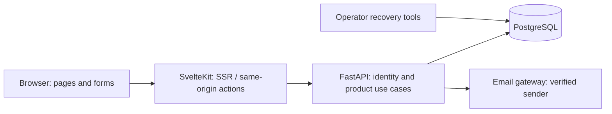

# First-beta architecture decisions

Status: selected architecture for #143 under delegated expert judgment. Implements the [product baseline](beta-decisions.md) when Claude Code receives implementation work; this document does not install packages, build the Svelte application, provision accounts, deploy, or validate hosting. Research checked on 2026-11-02; feasibility gates remain implementation/release work.

## Decision summary

| Concern | Decision | Why / consequence |
| --- | --- | --- |
| Application shape | One FastAPI application with feature modules and one PostgreSQL database; SvelteKit web delivery in front | Keep transactions and deployment simple; no microservices, Redis, queue, realtime system or duplicate backend |
| Frontend | Svelte 5 / SvelteKit 3 / TypeScript 6, native HTML controls, scoped CSS and a small reusable component set | Selected Svelte direction; no React/Chakra port or extra client-state/form framework by default |
| Rendering | SSR for public discovery/details and permitted profiles/posts; server-loaded private routes with progressive enhancement | Public links have useful initial HTML/metadata; private data does not depend on a browser global token |
| Adapter/host target | Official Cloudflare adapter on Workers with static assets; local Workers-compatible preview | Low-cost deployment candidate with a thin edge layer; CPU/runtime compatibility must be measured |
| Backend/database target | FastAPI Cloud Hobby plus Neon Free PostgreSQL 18; provider subdomains first | Reuse Python/Postgres while testing a no-paid-service starting point |
| Authentication | Opaque revocable backend sessions; same-origin HttpOnly cookie at the SvelteKit boundary | Immediate logout/reset/ban revocation without exposing a reusable browser-storage token |
| Data access | Browser → SvelteKit server → FastAPI → PostgreSQL. Server-only native fetch; generated public-safe TypeScript contract types | No browser-to-database or credentialed cross-origin browser API path; avoid the legacy mutable SDK token |
| Consistency | PostgreSQL transactions, owner-scoped reads, optimistic revisions and idempotent operations | Protect privacy, uncertain saves, publishing changes and bounded restore |
| Recovery | Own export plus empty-record transactional restore; separate encrypted operator database backups | User portability and whole-service disaster recovery are different responsibilities |
| Legacy prototype | Preserve old code/tables for reference but exclude unsupported operational routes from the deployed beta API | A hidden navigation item is not an access boundary; do not inherit manifest defects |

The cookie is scoped to the web origin. SvelteKit forwards its opaque credential to the fixed API origin over TLS; FastAPI validates the session and owns all authorization decisions. The diagram is a logical design, not a deployed system.

## A1 — Boundaries and dependency direction

Use feature modules for identity, directory/opportunities, personal records, social activity and moderation. Within each, keep policy/use cases separate from HTTP schemas and persistence adapters. Plain Python values/dataclasses cross policy boundaries; FastAPI requests, Pydantic transport models, SQLModel rows, environment settings and provider SDKs stay outside core policy.

Inner policy defines the small ports it needs: account/session lookup, owner-record storage, visible-post reading, unit of work, clock/ID source, email delivery and export/restore persistence. Concrete SQLModel/SQLAlchemy, HTTP, hashing/email and configuration adapters are wired at the application composition root. Do not create a generic service/repository hierarchy or empty architectural folders for every future feature. Extract a boundary when the first relevant use case needs it.

Keep important rules independently testable: baseline totals, actual gear use, visible publication projection, block/follow audiences, source-edit withdrawal, restore eligibility and reference ownership. Use fake ports for policy tests and real disposable PostgreSQL for adapter/transaction tests. Add an import-boundary check for the new policy modules; a package diagram alone does not enforce separation.

SvelteKit owns rendering, forms and browser transport concerns. It may validate input for feedback but cannot be the sole authority for ownership, quotas, follow approval or publication state. It does not query PostgreSQL or reimplement record-count/privacy rules.

## A2 — Framework and migration baseline

Registry inspection on the research date returned SvelteKit 3.1.1, Svelte 5.57.3, Vite plugin 7.3.1 and Cloudflare adapter 8.0.2. Kit declares TypeScript 6 and Vite 8 peers; the adapter declares Kit 3 and Wrangler 4 peers. Use compatible stable releases with a committed lockfile and recheck these declarations at implementation time; no installation was performed here.

Follow current SvelteKit 3 documentation: configuration belongs in the SvelteKit Vite plugin, not copied legacy `svelte.config.js` examples. Do not enable experimental remote functions/async compiler options merely because a documentation example contains them. Node 26 is the build/local tooling target from #170; Cloudflare production is a Workers runtime, not an assumed Node 26 server.

Create the replacement in `web/`, leaving `frontend/` as the React reference until agreed supported behavior and rollback are covered. Use standard forms/server actions and framework state first. Public contract types may be generated into `web/src/lib/contracts`; the native-fetch API adapter belongs in server-only modules and is instantiated per request. No mutable global `OpenAPI.TOKEN`, shared user store, browser localStorage credential, axios Node transport or React library enters the replacement by default.

The dependency update #170 and planning PR #168 are separate unmerged inputs at inspection time. Claude must reconcile their exact accepted/current heads in an implementation feature branch before coding; do not assume this documentation branch contains #170's upgraded application. The new authentication adapter must preserve the upgraded Argon2id/new-hash and legacy bcrypt verification behavior and meaningful tests, not revive the old Passlib pin.

## A3 — Routes, rendering and caches

| Route family | Rendering/access rule |
| --- | --- |
| Discover, opportunity, provider and DZ detail | Public SSR, only curated published data; no account needed for external organizer link |
| Opted-in person/profile and published card | SSR from backend visibility query; generic unavailable response when not permitted |
| Activity, records, gear, saves/plans and account | Server authentication before private loads; no private payload in unauthenticated HTML |
| Maintainer review | Backend role checks on every read/mutation; not just a client route guard |
| Sign in/register/verify/recover | Same-origin form actions, safe relative return destination and neutral recovery responses |

Prerender only truly static help/about/support pages. Database-driven discovery and social routes are not build-time snapshots. Produce share metadata from the same permitted projection as visible content; do not load a private jump to build an image/description.

Initially send `Cache-Control: no-store` on dynamic HTML, API data, errors, auth and exports, including public social content. Cache only fingerprinted static assets publicly. No service worker or private browser persistence. This trades more origin work for straightforward access revocation; #161 measures whether the free target can support it. Do not add shared caching without an explicit visibility/invalidation design.

Authenticated venue activity and anonymous venue activity are different authorized projections; never reuse one across viewers. Unpublish/block/revocation must deny subsequent reads. Already displayed pages, screenshots or external copies cannot be remotely erased; no live push guarantee is made. Disable speculative protected-data prefetching and paginate on user action to bound accidental calls.

## A4 — Identity, sessions and recovery

FastAPI owns the existing account identity, a persistent person/profile identity, credential verification and session storage. A session uses a cryptographically random 256-bit secret; store only its secure hash, account reference, expiry and revocation state. New login rotates the session; cap active sessions at five per account. Select seven-day absolute expiry without refresh/sliding keepalive for beta; explain expiry in the UI. Logout revokes the backend session and clears the cookie. Password reset/change, account suspension/deletion and explicit revoke-all invalidate all sessions as appropriate.

SvelteKit sets a production `__Host-organiser_session` cookie: Secure, HttpOnly, SameSite=Lax, Path=/, no Domain. It never returns the raw secret in HTML, page data, browser JSON or logs. Use an explicitly separate localhost-only development cookie configuration; production defaults must not silently drop Secure attributes. Request-local user state is minimal and cannot substitute for backend checks. Account switching clears previous private in-memory views/drafts.

New accounts verify their email before personal-data writes or publication. Keep guest discovery useful without verification. Email registration/recovery uses a gateway owned by the identity use case; no hosting platform becomes the account database. Password reset/verification tokens are random, hashed at rest, single-use and expire after 30 minutes. Recovery acknowledgements and throttling must not enumerate accounts. A real delivery path/verified sender and expiry/reset tests are release prerequisites; a free public sender is not assumed.

Require fresh password confirmation for restore, account deletion and sensitive account credential changes. An ordinary valid session can export its own records. Avoid adding another authentication platform, custom cryptography, MFA promise or provider-dependent identity flow in this beta.

## A5 — CSRF, CORS and transport

Use same-origin browser actions/route handlers only. Keep SvelteKit 3 CSRF protection active and do not add wildcard trusted origins. Additionally validate the exact configured application Origin on all unsafe browser methods, including JSON routes and login/logout; reject absent/null/mismatched origins for those routes. Test production-built behavior because framework development behavior differs. Accept the explicit localhost test origin only in isolated development/test configuration.

GET/HEAD never mutate. SameSite cookies supplement the Origin check; they are not the only defense. The API receives explicit backend-validated bearer credentials from SvelteKit and does not accept browser ambient auth cookies. No credentialed wildcard CORS. Cross-origin direct browser access is unnecessary for beta; CORS does not replace API authentication or protect against non-browser clients.

The web/API adapter uses an allowlisted fixed upstream origin/resource set and methods, not an arbitrary proxy URL. Do not forward browser-controlled actor/role headers or credentials across upstream redirects. Timeouts produce an uncertain-save state when the operation may have committed; retry only with the same operation identity. Sanitize error responses and logs; no passwords, tokens, private bodies, full serials or reset URLs in operational logs.

## A6 — Data/transaction contracts

[Data contracts](data-contracts.md) define records, dates, prior-history calculation, publication projection, errors, idempotency and bounded restore. PostgreSQL is authoritative; use foreign keys, uniqueness, owner predicates and transactions rather than client assumptions. An internal UUID is not permission to access a record.

Reuse account identity where justified. Do not turn the prototype operational `Jump` into a personal log or infer ownership from a matching name/email; it models a passenger/load assignment with insufficient ownership context. Add personal-record tables and additive migrations. Existing naive operational timestamps are unchanged unless a separate explicit migration is designed; new audit/publication/session instants use UTC-aware storage and personal activity dates use DATE.

Use a small connection pool (initially two connections/process, no overflow), bounded timeouts and one backend process per instance; measure hashing/memory/concurrency under the intended host. Neon application traffic uses its TLS pooled endpoint with psycopg/pooler compatibility tested; migrations, dumps and restore administration use a separate direct endpoint. Avoid session-level database state and advisory locks. Prefer optimistic compare-and-swap (product-owner decision, 2026-11-03): read a `version` (a column on the record, or a single-row gate for set-wide limits) with the data, write with `UPDATE … WHERE version = :read`, and on no match re-read and retry (server-side invariants) or answer a conflict the client must resolve (edits made from a stale view). Database constraints still guard uniqueness and references. Row locks are the fallback where a compare-and-swap cannot express the invariant; take them in a stable order. Registration uses a gate row (#145 lock replaced); the owner quota and directory/listing maintenance paths from #148–#150 still use row locks and move to compare-and-swap when next changed (#151 adds expected versions to reviewer edits).

## A7 — Initial limits and observability

These are conservative **design limits, not measured capacity**. Configuration can be reduced after testing without changing the product promise of readable/exportable existing records. Do not silently grow paid services.

| Limit | Initial implementation target |
| --- | --- |
| Active beta accounts | 25; registration switch/count enforced server-side, existing access preserved |
| Detailed jumps / gear / saves / private plans | 2,000 / 50 / 200 / 100 per account, also subject to byte budget |
| Current complete personal-export payload | 4 MiB UTF-8 compact JSON, including required references/provenance; writes reserve/check budget so an own export stays recoverable |
| Normal mutation / restore body | 64 KiB / 8 MiB uncompressed, bounded while streaming; no compressed or arbitrary binary import |
| Page size | 20 by default, maximum 50; stable cursor order |
| Export / restore attempts | 1 per account per 5 minutes / 3 per account per day, with support/recovery exceptions handled explicitly |
| Login failures | Initial per-IP-and-identifier and per-IP rolling limits; 10/15 minutes per pair and 50/15 minutes per IP, no permanent account lock |
| Account signup / reset requests | Global registration cap; initial reset 3/hour per identifier and 10/hour per IP with neutral responses |
| Storage headroom | Stop new growth at a conservative 600 MiB database watermark on the researched 1 GB free target; measure actual indexes/audit/storage overhead before beta |

Do not fetch 2,000 entries to count every time or transmit unnecessary private fields. Usage accounting and quota enforcement belong to backend use cases/transactions. At limits, permit read/export, shrinking edits, deletions and essential logout/recovery operations; cap errors never report a failed save as success. Restore review validates both row and current-export byte budgets before writes. Static rate numbers must be reviewed against actual login/hash behavior and public-host limits before launch.

Track sanitized operation IDs/statuses, request duration/errors, cold starts, connection pressure, account/data size, restore outcomes and backup age. Keep operational logs seven days maximum in our tooling where available, with no promise that a provider offers that retention free. Use no session replay, third-party advertising or hosted analytics dependency. Provider dashboards plus small aggregate application counters are sufficient initially.

## A8 — Hosting choice, cost and compatibility gate

Selected target: **Cloudflare Workers Free + FastAPI Cloud Hobby + Neon Free**, initially on provider subdomains. This is a documented target to test, not provisioned hosting, guaranteed availability or a supported-user estimate.

| Service / evidence checked | Fit | Must demonstrate before using real records |
| --- | --- | --- |
| Cloudflare official adapter/Free limits | Adapter supports Workers; free allowance currently lists 100,000 daily requests and 10 ms CPU/request | Build/SSR/auth cookie/actions work in actual Workers preview; CPU fits including worst permitted forms. Stream restore/export through the edge without parsing JSON or hashing passwords there |
| FastAPI Cloud Hobby | Pricing lists $0/no card, shared 512 MB and scale-to-zero; docs describe uv/Python selection | Install the pinned regular CPython 3.15/native wheels, run one process within memory, connect to database, execute migrations safely and measure cold starts/latency |
| Neon Free | Pricing currently lists $0/no card, 1 GB storage and bounded compute | PostgreSQL 18 availability/region, TLS pooler/psycopg transactions, separate migration endpoint, actual usage/restore allowance and backup access |
| Email delivery | Backend gateway with verified sender; no provider/account selected by this document | Real reset/verification delivery without unapproved payment/domain costs. Local Mailcatcher only proves development flow |
| Operator backup storage | Encrypted operator-controlled durable storage on an existing trusted machine, outside application/provider ephemeral disk | Actual destination, scheduling, key custody, restore and deletion replay; do not assume this machine is always online or provider retention is a complete backup |

Pricing research has limits: FastAPI Cloud's pricing page has differing replica ceilings in its overview/table; verify actual account controls rather than budgeting from either value. Free-provider allowances are changeable and not production SLAs. No automatic paid upgrade, card, custom-domain purchase, external object store or paid email plan is selected. If a target fails, keep work in isolated/local preview, record the failure and adjust the adapter/provider decision; do not solve it by weakening privacy, disabling recovery or quietly incurring charges. A portable Node adapter is the contingency, not a second deployed frontend or an assumed free server.

This closes the architecture comparison as a decision with testable assumptions. #144/#145 test the runtime/auth slice; #161 owns real host/quota/cold-start/backup proof before public beta. An untested deployment gate does not mean the architecture document itself is unfinished.

## A9 — Retention, deletion and operational recovery

Account deletion withdraws public cards and revokes sessions immediately, then deletes owned active personal records/derived references atomically under the chosen bounded-data model. No former follower/maintainer gains another account's private records. Keep only minimal moderation case evidence, with access limited to reviewers and a 30-day retention target; publish that exception clearly rather than promising universal instant erasure. Routine logs contain no private payloads. Gear corrections remain private, attributable self-reports while the record exists, not a permanent verified ownership registry.

Target one encrypted database backup per day, seven daily copies maximum, with documented key access and restore rehearsal; these are operating objectives, not a measured RPO/RTO guarantee. Backups include credentials and private data and never belong in source control, public build artifacts, or the app's ephemeral filesystem. Operator recovery uses direct database tooling, separate from a user's JSON restore. Keep a minimal deletion/revocation ledger outside the rolling backup set and apply it before restoring service from an older backup, so deleted accounts/cards and revoked sessions do not silently reappear. Validate the actual backup destination and schedule in #161; if unavailable, do not intake sole-copy user records.

A backend/database outage displays unavailable/unsaved state; no browser-only success. No cron keepalive to defeat sleeping free plans, no background worker or user-data queue assumed. Low-volume maintenance can use an explicit operator command or verified external schedule after deployment planning; expired session/token cleanup is bounded and does not authorize indefinite raw payload retention.

## A10 — Legacy isolation and release order

Deploy an explicit beta router/allowlist in a distinct `/api/skydiver/v1` namespace. Include only implemented beta identity, public directory, personal records, social, moderation and health endpoints. Do not mount the current aircraft/instructor/load/jump/weather/analytics, generic item, test-only private-user or blanket superuser-user-list endpoints in the public beta. Keep their code/tables for reference; fixes or later DZ adoption stay separately tracked. Do not migrate operational assignments into completed personal activity.

P1 ships the shell/request-local API boundary, then sessions/accounts, authorization/legacy isolation, then repository/CI integration. P2/P3 deliver discovery and personal records; P4 adds permitted completed-activity sharing; P5 proves actual release behavior/hosting/maintenance. User tests in #160 are not fulfilled by unit tests or a design mockup. No current legacy test result proves the new session architecture or Svelte app works.

## Sources and evidence limits

- [SvelteKit adapters](https://svelte.dev/docs/kit/adapters), [Cloudflare adapter](https://svelte.dev/docs/kit/adapter-cloudflare), [Kit 3 migration](https://svelte.dev/docs/kit/migrating-to-sveltekit-3), and [auth/session guidance](https://svelte.dev/docs/kit/auth). Framework choices and our transport policies are design decisions; runtime behavior is untested.
- [npm Kit metadata](https://registry.npmjs.org/@sveltejs%2fkit/latest), [Svelte metadata](https://registry.npmjs.org/svelte/latest), [adapter metadata](https://registry.npmjs.org/@sveltejs%2fadapter-cloudflare/latest): inspected peer/engine declarations, not an installed compatibility test.
- [Workers Free pricing](https://developers.cloudflare.com/workers/platform/pricing/) and [limits](https://developers.cloudflare.com/workers/platform/limits/).
- [FastAPI Cloud pricing](https://fastapicloud.com/pricing/) and [dependency/Python documentation](https://fastapicloud.com/docs/builds-and-deployments/install-dependencies/).
- [Neon pricing](https://neon.com/pricing), [PostgreSQL version support](https://neon.com/docs/postgresql/postgres-version-support), and [pooling/direct-connection guidance](https://neon.com/docs/connect/connection-pooling).

These sources describe vendor offerings or documented framework behavior. No account configuration, free-plan eligibility, transaction/latency benchmark, email sender, backup storage or deployment was verified through execution in this architecture task.
