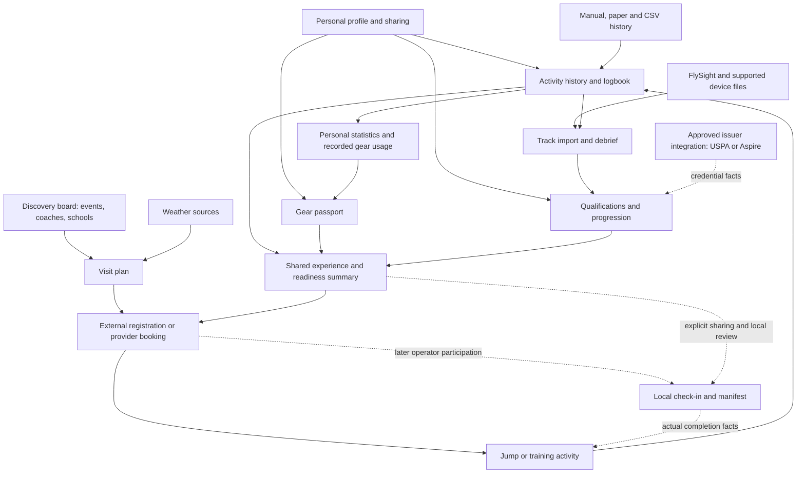

# Connected product model

Status: reconciled discovery proposal. Individual skydivers are the initial audience; no dropzones are ready to participate. This connects the feature inventory without selecting an MVP or authorizing implementation. It is a product responsibility model, not a database schema or a commitment to microservices.

First-beta selection: [product decisions](beta-decisions.md) take precedence over this broader ecosystem model. Plans remain private; shared intentions and standalone professional directories are later work. The baseline does not create historical activity, and own-export restore does not merge into existing records.

## One connected experience

Discover an opportunity → prepare → arrange participation → jump or train → record → review and progress → discover the next opportunity.

The loop works in smaller parts without participating operators: a jumper can find a listing, prepare records, register externally, manually log the activity, import a recording, and retain their debrief. Participating professionals and dropzones can later supply attributable confirmations and transactional services.

## Proposed user-facing areas

| Area | What the skydiver finds | Shared records it uses |
| --- | --- | --- |
| My skydiving | Profile, logbook, statistics, recent activity, qualifications, personal goals | Person, activity entries, credential evidence, training records |
| My gear | Components, serials, rig assemblies, ownership claims, service history, reminders | Gear components, dated associations, ownership and service events |
| Discover | Events, boogies, camps, coaches, courses, schools, and destinations | Provider, venue, listing, saved search, opportunity |
| Plans | Saved visits, forecasts, prerequisites, calendar, inquiries and later bookings | Visit plan, listing reference, weather context, participation state |
| Review and learn | Tracks, media, jump plans, feedback, exercises, and progression | Activity references, telemetry, briefing version, goals and sign-offs |
| People and activity | Followed jumpers, shared cards, venue activity, optional visit intentions | Follow relationships, audience-scoped posts, block/report state, explicit plans |

These are navigation proposals, not separate silos. For example, the same jump appears in a chronological logbook, a canopy's usage view, and a coach's authorized debrief view without creating three jumps.

## Feature ownership and boundaries

Each responsibility owns its rules and publishes information other features can use. References and explicitly shared views connect them; unrelated modules must not silently rewrite each other's records.

| Responsibility | Owns | Feature coverage | Participation |
| --- | --- | --- | --- |
| Identity and access | Person/account links, provider/organization identities, roles, sharing grants | F01; access for every feature | Personal account first; scoped professional/operator roles later |
| Personal activity history | Logbook entries, history migration, corrections, personal activity summaries | F02, F09 | Independent; operational records can supply suggestions later |
| Equipment history | Component identity, assemblies, ownership claims/transfers, servicing, usage projections | F04; equipment side of F15 | Private inventory independent; transfers/service confirmations need other people |
| Discovery and publishing | Provider/school profiles, venue directory, source-backed listings, moderation, following | Discovery portion of F10 and F15 | Community/source-linked discovery can work before providers join |
| Planning and participation | Visit plans, inquiries, applications, registration/booking state, inventory and payments if introduced | F05 context, F06, transactional part of F10 | Planning independent; accepted transactions require provider participation or integration |
| Learning and credentials | Goals, curricula, feedback/sign-offs, issuer-sourced credentials, requirement assessments | F03, F11; external USPA/Aspire link | Personal tracking independent; verification and formal acceptance conditional |
| Debrief and collaboration | Original telemetry, parsed tracks, derived metrics, media, briefing versions, team practice/results | F08, F12, F13, F14; collaborative portion of F15 | Personal review first; collaboration scoped; specialist services conditional |
| Social publication | Follows, selected activity summaries, shared intentions, audiences, block/report, moderation | Social portion of F15 | No operator adoption needed; other jumpers must participate for social value |
| Dropzone operations | Local readiness review, loads, all-occupant assignments, staff/aircraft/resources, actual completion facts | F07; operational side of F06 | Later operator adoption with tenant isolation |

Weather adapters, file parsers, notifications, calendar exports, search, and storage support these responsibilities. They do not own credential authority, ownership, bookings, or jump completion. Separate adapters translate external provider data rather than making a vendor's format the internal product model.

## Canonical terms and records

| Term | Meaning and ownership |
| --- | --- |
| Person | Stable identity for an individual; roles can vary by organization |
| Provider | Person or organization offering coaching, schooling, services, or events; management authority and qualification are separate attributes |
| Venue | Physical dropzone/tunnel/location; a directory entry is not an adopted operator workspace |
| Listing | Published discovery information pointing to a provider, venue, and offering/event; not bookable inventory by itself |
| Offering | A service or activity with terms; a dated occurrence may provide reservable capacity when a provider actually manages it |
| Visit plan | The user's intent to travel/attend; can reference several opportunities and forecasts without a booking |
| Participation record | Inquiry, application, registration, or booking with explicit state; an external confirmation can be user-recorded without claiming app synchronization |
| Activity entry | Personal record of an individual skydive or training activity; tunnel sessions remain a distinct activity kind |
| Operational assignment | A local place on a load, subject to local constraints; not yet a completed jump |
| Credential | A qualification/membership assertion from an identified source, with timestamps and evidence |
| Verification | Who confirmed which facts/version and when; not a generic verified-user badge |
| Requirement assessment | A purpose-specific view of records against a versioned provider/local requirement set; not a universal clearance |
| Gear component | Stable physical-item record independent of its current rig or claimant |
| Gear assembly | Dated grouping of components into a rig; assembly does not establish ownership |
| Ownership claim / transfer | Attributed declaration or sender/recipient-confirmed event; not automatic proof of title |
| Track / media attachment | Supporting data linked to activity; several recordings or videos can refer to one jump |
| Currency summary | Derived recent-activity view with sources, time window, and calculation date; distinct from membership validity and financial credit |

These are discovery concepts. Their exact schemas and formal lifecycle rules are not implemented.

The [dropzone directory workflow](dropzone-directory.md) makes venue attribution independent of registration: users can log at listed or provisional locations, duplicates can be resolved without duplicating jumps, and later operator claims preserve the venue identity without gaining access to private historical records.

## Integration map

Arrows represent information flow, not unconditional state transitions. A booking does not create a completed jump; actual activity must be established separately. External registration can remain outside the app. Private data only crosses a sharing boundary when the user authorizes it.

## Main connections and update rules

| Trigger | Connected behavior | Rule protecting accuracy |
| --- | --- | --- |
| Save a listing | Create/reference a plan and optional calendar entry | No registration, payment, or private-record disclosure |
| Submit an application | Share selected experience/gear/credential facts with that recipient | Record audience, purpose, record versions, and sharing terms |
| Provider accepts participation | Update the participation record and notifications | No automatic manifest assignment or training sign-off |
| Record a completed skydive | Update personal statistics, recent activity, and attributed component-use counts | Count the activity once, only for the gear actually associated with it |
| Import paper/CSV history | Propose reviewed entries or match existing ones | Batch provenance, ambiguity review, duplicate handling, and rollback |
| Import a track or delivered video | Attach to a matched entry or propose a draft | Same jump stays one entry; preserve originals and source limitations |
| Instructor signs an objective | Add attributable progression evidence | Completion belongs to the signed objective/version, not every future edit |
| Issuer data arrives | Update issuer-sourced credential facts and freshness | Do not overwrite user notes or treat one-time import as continuous sync |
| Rigger records servicing | Add a component service event and reassess reminders | Service scope is explicit; it does not transfer ownership |
| Buyer accepts a transfer | Add transfer event and change active recorded claim | Share agreed item history; keep seller-private documents and future buyer activity scoped |
| A notice may apply to gear | Display a sourced potential-match task | No automatic airworthiness decision; no match does not imply clearance |
| Organizer changes/cancels an event | Update listing, related plan/calendar, and opted-in alerts | Do not assume an external booking/refund was changed |
| Activity is corrected or removed | Recompute dependent summaries and flag affected reviews | Preserve source and correction history; handle signed/operational records separately |

Statistics, currency summaries, and equipment usage are derived views, not independent histories. Distinguish recorded component uses from lifetime totals when earlier usage is unknown. A brought-forward jump total does not invent gear usage or dates for a currency calculation.

## End-to-end journeys

### A — Individual use at a nonparticipating dropzone

Create a profile → register personal gear → add/import history → save a destination → inspect weather → jump outside the app's operations → add/review the activity → associate actual gear → attach a track/video → review personal trends and reminders.

No partner, issuer API, or new professional signature is required. Recording remains self-reported or imported according to its source. A forecast, log entry, and maintenance reminder retain their own authority limits.

### B — Find a school, camp, boogie, or coach

Browse listings using personal filters → save the opportunity into a plan → review prerequisites → follow an external registration link, or send an in-app inquiry if supported → record/receive the actual confirmation → attend → log actual jumps or distinct tunnel sessions → attach debriefs and learning goals.

School profile, dated course, venue, and instructor remain linked but distinct. A professional can manage listings or feedback without a dropzone adopting manifest software. Browsing or following does not share the jumper's profile with the provider.

### C — Buy, service, and transfer equipment

Register an item with serial and optional acquisition evidence → associate it with a rig → log actual uses → receive source-based reminders → share it with a rigger for servicing → retain the attributed service event → later share selected history with a buyer → complete a mutually confirmed transfer.

Historical jumps continue referencing the equipment used at that time. Transfer does not reassign the seller's jumps to the buyer, reset item lifetime usage, or reveal the buyer's future activity to the seller. Maintenance and ownership disputes remain separate.

### D — Later participating dropzone visit

Select an offering → authorize selected records → obtain actual booking acceptance → local staff review requirements → check in → assign all occupants/resources to a load → record actual completion → propose/match a personal log entry → attach personal telemetry and feedback.

Operational facts and the personal entry remain referenced records, not one globally editable row. Editing personal notes does not rewrite a dropzone's manifest. A correction to operational facts needs explicit reconciliation rather than overwriting the user's existing entry. Receiving another venue's history does not expose its private operations.

## Source, privacy, and lifecycle consistency

- Use stable references for people, activities, components, providers, and listings. Deduplicate and preserve cross-source identifiers rather than matching by name alone.
- Store source, effective time, recorded time, relevant version, and attribution. Source and verification may differ per fact within a record.
- Keep personal access independent of a dropzone membership. Use scoped roles for provider management and separate tenant access for operational workspaces.
- Share selected views with explicit audience/purpose. Record the evidence/version relied upon for a formal decision; revoking future access does not silently erase prior decisions. Retention rules remain open.
- Keep an organization's private notes, payment records, raw documents, full serials, and personal media out of public discovery/search.
- Social publication is deliberate and separate from logging. Venue pages and feeds reuse authorized cards; private logs/plans/device recordings cannot imply public presence. See [social activity](social-activity.md).
- Validate critical transfers, inventory, and occupant reservations consistently at the time of the action. Statistics/search/notifications can update afterward with visible freshness where relevant.
- Make imports, callbacks, and completion processing safe to retry; match existing entries and report conflicts rather than double-counting.
- Preserve deletions/corrections in the appropriate history. An independently retained professional/operational record and the jumper's editable copy require explicit ownership and retention rules.
- Offline drafts must show pending status; they cannot promise live capacity, issuer freshness, or acceptance while disconnected.

## Reconciliation of overlapping scope

| Overlap in the inventory | Reconciled responsibility |
| --- | --- |
| Events/camps in F10 and competitions in F14 | F10 publishes discoverable opportunities; participation tracks registrations; F14 adds specialist team/results/scoring capabilities |
| Coaching in F10 and progression in F03/F11 | F10 finds the provider/offering; F06 handles accepted participation; F11 records learning; F03 presents credential and activity evidence |
| Media in F02/F08/F13 | Activity history references attachments; F08 processes telemetry; F13 manages media/review permissions |
| CSV migration in F08 and paper migration in F09 | Both propose personal-history entries; telemetry import remains a different pipeline |
| Gear ownership and a future F15 marketplace | Equipment history owns item claims/transfers; a sale listing only references the item and authorized disclosure |
| Saved listing, booking, load, and log entry | Intent, accepted participation, operational assignment, and personal completion record are separate states/records |
| Membership, credentials, currency, and eligibility | Issuer status, qualification assertions, derived recent activity, and a receiving party's local decision remain distinct |
| School/coach identity and credentials | Account/provider management authority does not establish instructor qualifications or federation recognition |
| Forecasts, observations, and operator status | Planning evidence, measured station conditions, and local announcements remain separate sources |

## Dependencies and discovery sequence

1. Shared foundations: personal identity, permissions, record provenance, location/units/time conventions, import matching, and export.
2. Independent feature paths: personal history; gear inventory; source-backed discovery; plans/weather; personal debrief and goals. Investigate them in parallel conceptually; none requires a complete manifest or formal qualification integration.
3. Optional participation: provider-managed listings, inquiries/acceptance, credential import if approved, coach/rigger confirmations, and collaborative review.
4. Later operator adoption: isolated workspaces, local check-in, capacity-backed booking, and manifest operations with validated operational constraints.

School/coach participation and event registration do not inherently depend on dropzone manifest adoption. No feature in steps 1–2 should require USPA API access or a third-party account connection to remain useful.

This is a dependency map, not selected release scope. Open decisions include the first individual segment, retention/correction policy, exact currency requirements, booking and financial responsibilities, and which professional/issuer integrations can actually be obtained.

## How this changes the repository assessment

The existing aircraft/load/jump tables are an operational prototype. They do not yet provide the personal activity, ownership, discovery, participation, or credential boundaries above. Keep their implementation blockers recorded, but do not make repairing the whole operations product a prerequisite for documenting skydiver-facing paths. No architectural refactor or new feature has been implemented as part of this reconciliation.

See the [feature catalog](feature-catalog.md) for the full inventory, [adoption strategy](adoption-strategy.md) for the audience direction, and [roadmap](roadmap.md) for conditional future stages.
